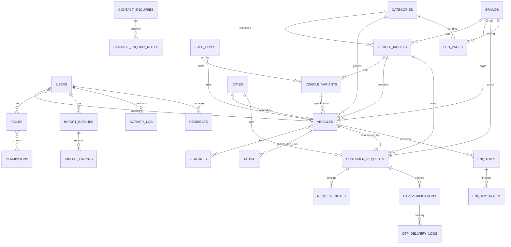

# WheelDeal — ERD and database notes

Mermaid source is included below. MySQL 8, InnoDB, utf8mb4. All tables have `created_at` and
`updated_at` unless noted. Soft deletes are used on `vehicles` only.



## Table catalogue

### Identity and permissions

| Table | Important columns | Notes |
|---|---|---|
| `users` | name, email, phone, password, is_active, last_login_at | Filament login + future API auth |
| `roles`, `permissions`, `model_has_roles`, `role_has_permissions` | Spatie | `Super Admin`, `Editor` |
| `personal_access_tokens` | Sanctum | ready for app tokens |
| `activity_log` | log_name, description, subject, causer, properties | admin audit trail |

### Catalog

| Table | Important columns | Indexes / constraints |
|---|---|---|
| `categories` | name, slug, description, icon, meta_title, meta_description, is_active, sort_order | unique slug |
| `brands` | name, slug, description, short_description, meta_title, meta_description, is_featured, is_active, sort_order | unique slug, index active/featured |
| `vehicle_models` | brand_id, category_id, name, slug, description, meta_*, is_active, sort_order | unique (brand_id, slug), index category |
| `fuel_types` | name, slug, is_active, sort_order | unique slug |
| `cities` | name, slug, state, is_active | unique slug, index state |
| `vehicle_variants` | vehicle_model_id, name, slug, fuel_type_id, transmission, engine_cc, power_bhp, torque_nm, mileage_kmpl, seats, price_min, price_max, is_active | unique (vehicle_model_id, slug) |
| `features` | name, slug, category, icon, is_active | unique slug |
| `vehicles` | uuid, title, slug, brand_id, vehicle_model_id, vehicle_variant_id, category_id, fuel_type_id, city_id, year, price, original_price, km_driven, owner_count, transmission, seats, colour, registration_state, registration_year, engine_cc, power_bhp, torque_nm, mileage_kmpl, description, condition, status, featured, popular, views_count, meta_title, meta_description, og_image, published_at, sold_at, created_by | unique (vehicle_model_id, slug); indexes on every filter field; soft deletes |
| `vehicle_feature` | vehicle_id, feature_id | composite primary |
| `media` | model_type/id, collection_name, file_name, conversions, custom_properties, order_column | medialibrary; `gallery` + `360-frames` |

### Customer demand

| Table | Important columns | Notes |
|---|---|---|
| `customer_requests` | uuid, type(sell/buy), status, name, phone, email, city_id, brand_id, vehicle_model_id, year, km_driven, expected_price, condition, colour, message, consent, otp_verified_at, admin_notes, assigned_to, ip_address, user_agent | photos via `request-photos` media collection |
| `request_notes` | customer_request_id, user_id, note, is_internal | timeline |
| `enquiries` | uuid, vehicle_id, name, phone, email, message, status(new/contacted/closed), admin_notes, ip_address | detail-page enquiries |
| `enquiry_notes` | enquiry_id, user_id, note | timeline |
| `contact_enquiries` | uuid, name, phone, email, subject, message, status(new/contacted/closed), admin_notes, ip_address | contact page |
| `contact_enquiry_notes` | contact_enquiry_id, user_id, note | timeline |

`customer_requests.status` values: `pending_verification`, `new`, `contacted`, `approved`,
`rejected`. `pending_verification` is an internal pre-OTP state; the admin-visible workflow
starts at `new` once verified.

### OTP

| Table | Important columns | Notes |
|---|---|---|
| `otp_verifications` | uuid, verifiable_type/id, phone, channel, code_hash, attempts, max_attempts, expires_at, last_sent_at, verified_at, ip_address | bcrypt hash only, 5 min, 3 attempts |
| `otp_delivery_logs` | otp_verification_id, provider, channel, status(queued/sent/failed), provider_message_id, error, payload | no OTP code stored |

### Imports and SEO

| Table | Important columns | Notes |
|---|---|---|
| `import_batches` | uuid, user_id, original_name, stored_path, status, total_rows, processed_rows, success_rows, error_rows, error_report_path, started_at, finished_at | queued import status |
| `import_errors` | import_batch_id, row_number, column, message, row_data | downloadable CSV |
| `seo_pages` | category_id, brand_id nullable, slug, h1, meta_title, meta_description, intro_copy, is_active | one override per category/brand pair |
| `redirects` | old_path, new_path, model_type, model_id, status_code, hits, last_hit_at | unique old_path; 301 on slug change |

## Index plan (filter columns)

```sql
vehicles: INDEX (status, published_at), INDEX (status, price),
          INDEX (status, year), INDEX (status, km_driven),
          INDEX (brand_id, status), INDEX (vehicle_model_id, status),
          INDEX (category_id, status), INDEX (fuel_type_id, status),
          INDEX (city_id, status), INDEX (transmission, status),
          INDEX (owner_count, status), INDEX (seats, status),
          INDEX (colour, status), INDEX (is_featured, status),
          INDEX (popularity_score, status)
customer_requests: INDEX (type, status), INDEX (phone), INDEX (created_at)
otp_verifications: INDEX (phone, channel), INDEX (expires_at),
                   INDEX (verifiable_type, verifiable_id)
media: medialibrary defaults + INDEX (model_type, model_id, collection_name)
```

## Delete rules

- Deleting a brand is restricted while models/vehicles exist (admin validation + policy).
- Deleting a category is restricted while models/vehicles exist.
- Vehicles soft-delete so old URLs can redirect and enquiries retain context.
- Customer requests/enquiries are never hard-deleted from the panel (audit trail).
- Media follows its model; exports and import reports are pruned by scheduler.
